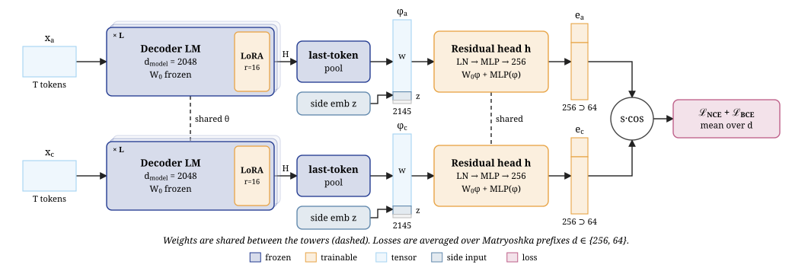
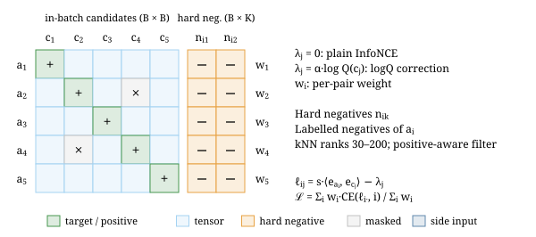

# Make Figure

A Claude Code / Agent skill that draws neural-network figures in the style of ML papers. It produces:
- **interactive HTML:** hover for tensor shapes and details, click to trace the data flow, step through the forward pass, filter by tag, export SVG/PNG;
- **static SVG:** for READMEs on GitHub/GitLab, where scripts don't run.





## Layout

Figures use short connections and a canvas fitted to their content. Read the
[compact layout guide](skills/make-figure/references/compact-layout.md).
After a change, render and inspect both examples before delivery.

## Font

All figure text uses Newsreader and black ink. Figures have no visible title
unless requested. Regular and italic font files are embedded
in the SVG, so browser previews do not need a local font installation.
The font uses the SIL Open Font License; see `assets/fonts/OFL.txt` inside the skill.

## Colours

The default palette follows the supplied AF3 reference: navy, orange, green,
sky blue, steel blue, grey and pink. Each colour has a fixed role. See the
[palette table](skills/make-figure/references/spec.md#default-palette).

## Install

As a Claude Code plugin, from the terminal:

```bash
npx @anthropic-ai/claude-code plugin install make-figure --marketplace WeihangGuo/make-figure
```

or inside Claude Code:

```
/plugin install make-figure --marketplace WeihangGuo/make-figure
```

On Claude Code older than 2.1.275, add the marketplace first:

```bash
npx @anthropic-ai/claude-code plugin marketplace add WeihangGuo/make-figure
npx @anthropic-ai/claude-code plugin install make-figure@make-figure
```

As a bare skill:

```bash
git clone https://github.com/WeihangGuo/make-figure /tmp/dlpd && cp -r /tmp/dlpd/skills/make-figure ~/.claude/skills/
```

Then ask Claude for something like *"draw the architecture of this model like in a paper"*.

## Use without Claude

```bash
python3 skills/make-figure/scripts/render.py skills/make-figure/examples/two_tower_lora.json -o out   # out/two_tower_lora.svg + .html
```

The renderer uses the Python standard library only. The spec format is in [references/spec.md](skills/make-figure/references/spec.md), the workflow and style rules in [SKILL.md](skills/make-figure/SKILL.md).

## License

MIT

Based on [Genndoso/dl-paper-diagrams](https://github.com/Genndoso/dl-paper-diagrams). The original MIT copyright notice is retained.
